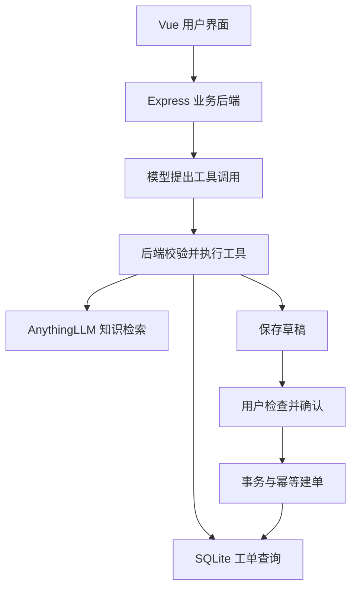

# 星舟知识问答与工单协作台

基于 Vue 3、Express、SQLite 与 AnythingLLM 的个人 AI 应用项目。将知识检索、已有工单查询、草稿准备和用户确认建单串联起来，支持查看来源和工具执行记录。

> 本项目使用 AI 编程工具辅助开发，面向本地学习与功能演示。示例知识库为虚构资料。AnythingLLM 提供文档处理和 RAG 能力；本仓库实现业务界面、接口适配、工具执行、草稿确认和工单持久化。

## 功能与验证

- 知识问答：通过后端访问 AnythingLLM，展示回答与可展开的结构化来源片段。
- 工单管理：字段校验、SQLite 持久化，刷新页面后可查看记录。
- Agent：模型选择 `search_knowledge`、`query_tickets`、`prepare_ticket`，后端校验工具名、参数、前置条件与执行预算。
- 人工确认：准备草稿不会创建工单，用户确认后才写入正式工单。
- 重复问题提示：查询同环境、同错误码的未关闭工单，由用户决定是否新增。
- 幂等：同一键及相同请求返回原工单；同键不同内容返回 HTTP 409，工单与幂等记录通过事务一起提交。
- 响应处理：过滤显式 `<think>` 标签内容，保留最终回答；识别上游 HTTP 200 中的业务失败。

2026-10-20 本地复核：13 项自动化测试通过，TypeScript 检查与 Vite 构建通过。人工联调覆盖知识问答及来源核对、数据库落库、重复提交和 Agent 确认建单。自动化测试使用隔离数据库或依赖替身，不代表线上准确率或并发能力。

## 流程



## 技术栈

Vue 3 / TypeScript / Vite / Node.js 26+ / Express / node:sqlite / AnythingLLM / OpenAI 风格 Tool Calling。

当前 Agent 适配 SiliconFlow Chat Completions 接口，模型需支持工具调用。知识问答通过独立运行的 AnythingLLM 服务完成；本仓库不包含 AnythingLLM 服务及模型权重。

## 本地运行

准备 Node.js 26+ 与 npm，然后在仓库根目录执行：

```powershell
npm ci
Copy-Item .env.example .env
```

只使用工单管理时，无需模型配置。知识问答与 Agent 功能需要：

1. 自行启动 [AnythingLLM](https://github.com/Mintplex-Labs/anything-llm)，配置聊天模型和嵌入模型，创建工作空间。
2. 将 [虚构示例知识库](docs/示例知识库-登录故障处理.md) 导入并完成嵌入。
3. 在 AnythingLLM 创建开发者 API Key，取得工作空间 slug。
4. 编辑本地 `.env`，填写 AnythingLLM 服务的 API 地址、API Key、工作空间 slug；Agent 使用 SiliconFlow API Key 和可用的工具调用模型 ID。可用模型与计费以服务商实际账户为准。

```dotenv
ANYTHINGLLM_BASE_URL=http://127.0.0.1:3001/api/v1
ANYTHINGLLM_API_KEY=填写你自己的Key
ANYTHINGLLM_WORKSPACE=填写工作空间slug
AGENT_MODEL_API_KEY=填写你自己的SiliconFlowKey
AGENT_MODEL=填写支持工具调用的模型ID
```

以上服务地址仅为示例，替换为实际地址。配置仅保存在本机，不上传 `.env`。

分别打开两个终端：

```powershell
# 终端一：业务后端
npm start
```

```powershell
# 终端二：Vue 开发服务器
npm run dev:web
```

打开 `http://127.0.0.1:3101`，后端健康检查为 `http://127.0.0.1:3100/api/health`。数据库自动创建在 `data/`，不随仓库发布。

## 复现演示

1. 提问“access_token 的有效期是多久？”，核对回答及来源是否包含“30 分钟”。
2. 提问知识库未覆盖的问题，检查是否明确缺少依据。
3. 输入“测试环境登录返回401，发生时间2026-10-20T12:00:00+08:00，复现步骤为打开登录页、提交虚构凭据、返回401，请准备工单草稿”。
4. 查看工具执行记录、重复工单提示及草稿，确认此时没有新增正式工单。
5. 点击确认，检查列表出现工单；重复确认应返回同一个工单。

## 检查命令

```powershell
npm test
npm run build:web
```

## 主要接口

| 接口 | 用途 |
| --- | --- |
| `GET /api/health` | 健康检查 |
| `GET /api/tickets` | 工单列表 |
| `POST /api/tickets` | 提交工单，支持 `Idempotency-Key` |
| `POST /api/knowledge/ask` | 知识问答 |
| `POST /api/agent/run` | Agent 多轮工具调用 |
| `POST /api/agent/drafts/:id/confirm` | 用户确认草稿 |

## 项目边界

当前为单机本地演示，未实现多用户鉴权、租户隔离和跨会话长期记忆；用户确认不等同于身份认证。工具调用次数受限。没有完成生产压测、问答准确率评测或高可用部署，不应直接开放到公网提供服务。

后续可增加用户与工作空间权限、正式评测集、请求限流、部署与监控。SnailJob 回调重试是另一项待实现计划，不属于本仓库已完成能力。
